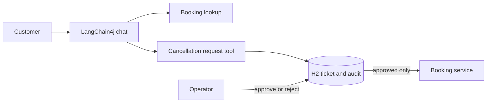

# Agentic Support Platform

A Java customer-support demo built on [Marcus Hellberg's java-ai-playground](https://github.com/marcushellberg/java-ai-playground), pinned to upstream commit `a06ad993326770921e496bc20e26802363e1728c`. The upstream project provides the Vaadin/Hilla chat UI, airline booking data, LangChain4j chat, RAG over terms of service, and booking lookup tools. This fork adds support tickets, approval before cancellation, persisted status and audit records, an operator panel, deterministic demo data, and workflow tests. The upstream MIT license is retained.

## Safety boundary

The model can retrieve booking details and **request** a cancellation. It cannot execute one. A request creates a `PENDING_APPROVAL` ticket. A human operator approves or rejects it through the operator API or page panel. Approval uses compare-and-set status updates so a repeated approval does not repeat the action. Execution failure goes to `MANUAL_REVIEW` and never retries automatically.

## Run

Requirements: Java 21, Maven, Node.js for Vaadin frontend, an OpenAI API key. Set `OPENAI_API_KEY` and a long random `SUPPORT_OPERATOR_KEY`, then run `mvn test` and `mvn spring-boot:run`. Open <http://localhost:8080>. The H2 database is stored under `./data/`. Alternatively copy `.env.example` to `.env`, fill both values, and run `docker compose up --build`.

Demo booking `102` belongs to Jane Smith and is at least two days in the future. Ask the chat to cancel booking 102 for Jane Smith. The assistant should return a ticket ID and say that cancellation awaits operator approval. Enter the operator key in the ticket panel and refresh. Approve or reject the ticket, then refresh bookings. For a rejection demonstration, create a fresh ticket and reject it. No real airline or payment API is called.

## Operator API

`POST /api/tickets` accepts `{ "bookingNumber": "102", "firstName": "Jane", "lastName": "Smith", "requestText": "Please cancel" }`. The operator endpoints require `X-Operator-Key: <SUPPORT_OPERATOR_KEY>`:

- `GET /api/tickets`
- `GET /api/tickets/{id}` and `GET /api/tickets/{id}/audit`
- `POST /api/tickets/{id}/approve` and `POST /api/tickets/{id}/reject`

The key is a demo operator secret, not a production identity system. The chat and booking demo are anonymous, and booking data resets on restart. Tickets and audit entries persist in H2. Do not deploy this publicly with real customer data.

## Verification

`mvn test` covers approval, repeated approval, rejection, unknown bookings, and unsupported actions. The acceptance scenario is: lookup → cancellation request → pending approval → approve → one cancellation and one execution audit entry; or reject → booking stays confirmed. Save a screen recording of both flows after starting the app with your own key.

## Fork notes

The imported source is an upstream archive because `git clone` could not reach GitHub from the implementation environment. The first local commit records the archive import; `upstream` points to the original repository. Modified and new files remain distinguishable in subsequent commits. No API keys are committed.

To run the HTTP workflow without a model key, pass `--support.rag.ingest-on-startup=false` and use a placeholder `OPENAI_API_KEY`; chat and RAG calls will still require a valid key. This mode is for local API verification only.

The current demo uses the upstream LangChain4j 0.35.0 and Vaadin 24.4.11 stack. The project is intentionally pinned for a narrow workflow upgrade; framework version migration is a separate change and should be tested against its breaking APIs.

The supplied Docker image runs Vaadin in development mode to keep the fork reproducible without a separate frontend deployment. It is intended for local demonstrations, not public hosting.
